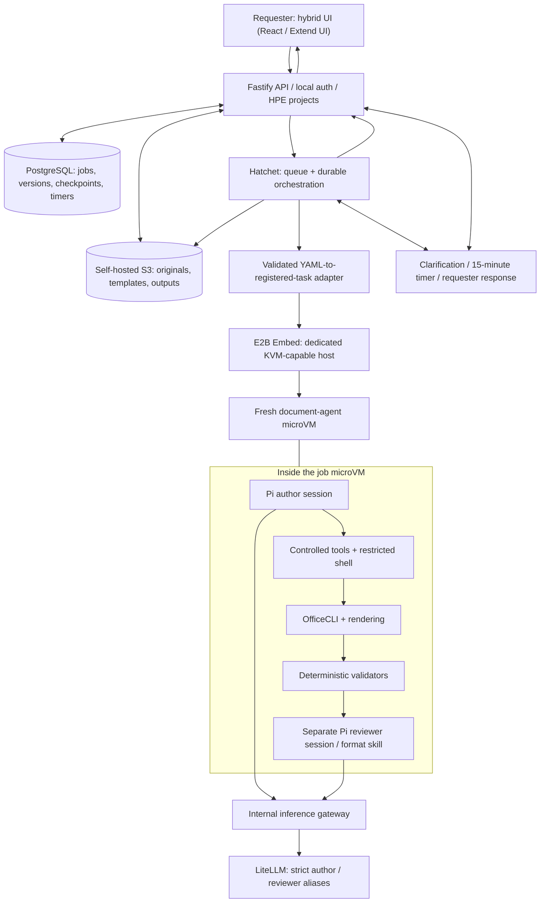

# Project Documentation Assistant — Product and Architecture (Version 3)

> **Status:** Product definition and architecture decisions; not an implemented application.  
> **Last consolidated:** 2026-11-02  
> **Repository:** https://github.com/Ntrakiyski/workflow-agents  
> **Scope:** One living project document. This is a requirements and architecture handoff, not executable configuration or permission to modify production documents.

## 0. How to read this document

This document consolidates (1) the original **Project Documentation Assistant — Product and Requirements Handoff** dated 2026-11-02 and (2) the decisions subsequently made in the architecture workshop.

**Decision labels:**

- **Agreed / selected:** The user explicitly chose this direction. Implementation and verification may still be outstanding.
- **Preferred / proposed:** A candidate or recommendation, not an accepted final choice.
- **Open:** Requires research, specification, or a later decision.
- **Existing asset:** A capability reported in the original handoff; not evidence that the new platform exists.

For conflicts, later explicit user decisions take precedence. In particular, the latest rules on **HITL, requester completion, general feedback, and 15-minute timeouts** replace earlier proposals for separate human approval, indefinite waiting, or inline comments. No performance, security certification, hosting compatibility, or end-to-end production capability is claimed.

---

## 1. Executive summary and product vision

Build an internal, self-hosted **document automation platform** where an employee selects a prepared automation, supplies rough text and attachments, and receives a formatted, reviewable document. The system interprets the input against the chosen template, asks targeted questions when materially necessary, generates a draft, performs independent validation, and allows revisions later.

A second user experience lets authorized people **onboard, configure, test, version, and reuse automations** around their own document templates. Users should not need to understand YAML, agents, skills, document field paths, or programming.

The platform grows from existing HPE Oden document workflows. It is **not restricted to AI Factory** and should eventually support multiple projects and document families.

**Primary product goals**

- Turn informal instructions, bullets, screenshots, and supporting documents into high-quality deliverables.
- Make document structure, source mapping, rules, evidence and validation reusable.
- Keep agent behavior constrained by versioned, declarative workflows.
- Preserve originals, revisions, uncertainty, and provenance.
- Execute each job in a fresh sandbox while retaining durable job history.
- Make human involvement exceptional: clarify significant ambiguity and let the requester ask for changes.
- Start with proven, narrow automations and expand only after real validation.

**Not promised**

- Universal understanding of every arbitrary template without onboarding.
- Factual correctness when sources are absent or contradictory.
- Automatic acceptance of test execution based on screenshots or prose alone.
- Identical editing/preview fidelity across DOCX, XLSX, PPTX, and PDF.
- Editing or publishing controlled live project documents without separately granted permissions.
- Organization-wide approval or measured business savings; neither has been established.
- A working application, deployed infrastructure, or finished YAML engine today.

### Why the product exists

Teams currently assemble project documentation from notes, requirements, meeting records, transcripts, screenshots, recordings, and previous deliverables. Challenges include deciding where material belongs in a template, locating defensible evidence, identifying missing information, preserving formatting/comments/revisions, and repeating comparable work across projects.

The original meeting summary supported a phased demonstration, broader applicability than AI Factory alone, a non-developer UI, and proving value using real projects rather than infrastructure-first work. It did not settle ownership, budget, delivery dates, hosting, or the final model.

---

## 2. Four product pillars

### Pillar 01 — User Experience

**Purpose:** The frontend used to request, follow, review, and revise documents.

**Capabilities**
- Browse an automation library and understand each automation's purpose, supported inputs, and limitations.
- Select an automation (for example, SRT), enter free-form instructions and upload notes, files, and screenshots.
- Use a **hybrid request screen**: automation selection + one main natural-language area + attachments, not a large mandatory field-by-field form.
- Show **workflow steps, status, progress, and errors** rather than only a generic spinner.
- Surface clarification questions in the same originating job UI.
- Preview generated documents in the application and download outputs.
- Accept **general revision instructions with text and optional images/screenshots**; inline document comments are **not required**.
- Preserve access to a job's full history so the requester can return days later and request another version.

**Technology direction:** React selected direction; Extend UI preferred candidate for document-oriented components; SSE selected for backend-to-UI job notifications. Actual component fit, preview fidelity, and upload approach require evaluation.

**Goal:** Let employees work with documents and automations without needing to understand the underlying infrastructure.

### Pillar 02 — Automation Builder

**Purpose:** Create and maintain reusable, controlled document-generation procedures.

**Capabilities**
- Upload an existing template; optionally assist with creating a starting template.
- Describe its purpose and intended audience.
- Inspect the template and propose section, table, image, field, cell, or slide mappings.
- Let the automation owner review and adjust those mappings.
- Define required information, terminology, formatting constraints, evidence rules, and output expectations.
- Define ordered workflow steps, permitted operations, conditions, clarification policies, validation gates, format-specific review skills, and checklists.
- Test representative inputs, inspect sample outputs, refine the definition, and create a versioned release.
- Optionally publish for authorized project/team use; exact automation-owner roles and library scopes remain open.

**Technology direction:** **Versioned YAML automation definitions** inspired by the declarative idea of Google's AX, but **not an adoption of AX**. Our YAML will be our own validated schema, translated by an adapter to registered Hatchet tasks. A visual builder is a product objective, not a completed design.

**Goal:** Configure a document workflow once and reuse it consistently without rewriting application logic.

### Pillar 03 — AI & Document Engine

**Purpose:** Analyze source material and generate, edit, render, validate, and review documents.

**Capabilities**
- Use Pi to interpret rough inputs, extract factual content, identify contradictions, and produce a structured content/placement plan.
- Validate the plan **before** modifying the template.
- Perform document operations through OfficeCLI behind controlled tool wrappers.
- Use global operational skills plus automation-specific skills.
- Perform structural and rendering checks independent of Pi's self-assessment.
- Start an **independent Pi reviewer session** after authoring, applying format-specific review skills and YAML-defined checklists.
- Route defects back for **bounded automatic author repair and revalidation**.
- Preserve uncertainty rather than invent facts or test verdicts.

**Selected direction:** Pi Agent, OfficeCLI, separate author/reviewer sessions, LiteLLM model access, and a fresh E2B microVM per execution. Restricted shell is allowed in addition to wrappers, subject to enforceable command/path restrictions.

**Goal:** Combine constrained AI interpretation with reliable, testable document manipulation.

### Pillar 04 — Platform & Governance

**Purpose:** Run the service for HPE projects with durable state, controlled access, auditable jobs, and isolated execution.

**Capabilities**
- Local user accounts; **one initial organization named HPE**.
- Projects with authorized members and access isolation.
- Data model designed to permit more organizations later, without initially exposing a multi-organization UI.
- Persistent jobs, automation versions, original uploads, clarifications, documents, revisions, and validation reports.
- Queue and orchestrate runs, retries, timers, and job progress.
- Create fresh microVMs, constrain resources and networking, export artifacts, and destroy sandboxes.
- Enforce authorization and retention policies; manage backups, failures, and operational visibility.
- Distinguish "generated", "validated", "delivered", and "automatically finalized" from **explicit human approval**.

**Technology direction:** Fastify/Node.js, Hatchet, PostgreSQL, self-hosted S3-compatible object storage, and E2B Embed. Some items are selected; exact implementations, deployment, authentication libraries, and operational controls remain unverified.

**Goal:** Make the platform trustworthy and maintainable for multiple HPE projects and future growth.

---

## 3. Eight-layer technical architecture

These are **logical layers**, not necessarily eight servers or processes.

| Layer | Responsibility | Direction / decision |
|---|---|---|
| **01. UI** | Requests, attachments, workflow progress, preview, feedback | React + Extend UI (Extend UI preferred), SSE |
| **02. Backend API** | Local login, authorization, project access, job and feedback APIs | Node.js + Fastify; one HPE organization |
| **03. Storage & state** | Durable metadata, checkpoints, original and generated files | PostgreSQL + self-hosted S3-compatible storage |
| **04. Workflow execution** | Queue, orchestrate, retry, wait, resume, enforce YAML steps | **Hatchet** replaces Graphile Worker |
| **05. Sandbox infrastructure** | Fresh job computer, resource controls, isolation and teardown | **E2B Embed** on dedicated KVM-capable host |
| **06. Agent and tools** | Plan, author, manipulate, render, validate, independently review | **Pi + OfficeCLI + global/job skills + wrappers** |
| **07. Model gateway** | Authorized inference, model selection, quotas | Existing **LiteLLM**, accessed through an internal gateway |
| **08. HITL & lifecycle** | Clarification, timeout, requester delivery and later revisions | Controlled clarification UI + 15-minute policies |

### Architecture diagram



The diagram is a conceptual responsibility map; it does not imply that the microVM can directly reach PostgreSQL, S3, or the Hatchet control plane. File movement and state changes are mediated by trusted services. The deployment split and precise connector APIs still need design.

### Golden environment

Build and version **one universal document-agent template** instead of repeatedly installing tools per job:

```text
document-agent:v1 (conceptual)
├── Linux userspace + Node.js
├── Pi runtime
├── OfficeCLI
├── Global agent skills
├── Controlled document tool adapters
├── Render and validation dependencies
└── Job workspace (empty in the golden template)
```

The automation version, inputs, template files, permitted model identity, and job-specific skills/rules are supplied to each execution. **No customer files, permanent API credentials, or job-specific sessions** belong in the reusable golden image.

E2B Embed templates are selected; snapshot restoration and startup latency must be measured. A warm pool was **not selected**. The host must provide KVM and enough CPU, RAM, disk, and networking capacity for the chosen hard limits.

---

## 4. Complete request-to-document workflow

**Example:** A requester chooses the existing `srt-docx-template` automation and supplies rough notes, technical steps, and screenshots.

1. **Submit in UI:** Requester chooses the automation, enters natural-language instructions, and uploads files.
2. **Authenticate and authorize:** Fastify checks the local user, HPE project membership, allowed automation, and upload policy.
3. **Persist:** Original files are stored in self-hosted S3-compatible storage. PostgreSQL records the request, immutable automation version, input references and job metadata.
4. **Start workflow:** The backend launches a Hatchet workflow; Hatchet is both **queue and durable workflow service**. There is **no Graphile Worker**.
5. **Resolve YAML:** A constrained adapter validates the published YAML schema and dispatches only registered task handlers. YAML is not executable shell code, and Hatchet does not natively execute this custom schema.
6. **Provision:** A trusted worker asks E2B Embed to create a **fresh microVM from the versioned golden template**.
7. **Stage:** Move authorized inputs and automation instructions into the sandbox. Establish per-job limits and controlled access to the inference gateway.
8. **Author:** One Pi author session works on the **entire job execution**; it interprets material using the backend-selected LiteLLM model alias. A structured content/placement plan must be validated before edits.
9. **Clarify when material:** Pi may call the structured clarification wrapper. Hatchet checkpoints the execution, the sandbox is destroyed, and the UI receives the question. Resumption uses saved state in a fresh microVM. See §7 for timeout rules.
10. **Generate:** Pi uses permitted wrappers and, where necessary, a **restricted shell** to operate OfficeCLI inside the sandbox. Originals are not modified.
11. **Validate:** Independent deterministic checks inspect structure, required content, output integrity, supported evidence rules, and rendered appearance.
12. **Challenge:** A **new, separate Pi reviewer session** runs the relevant format-specific review skill against the actual file, template, sources, content plan and checklist. It is not just another message in the author's session.
13. **Repair, if needed:** Bounded author repair and revalidation run under Hatchet control. Critical failures remain blocked; a reviewer's optimistic verdict cannot override deterministic gates.
14. **Export and teardown:** Trusted orchestration saves the document, previews, reports, and logs/checkpoints as permitted, then destroys the execution microVM.
15. **Deliver:** The UI shows the document as **awaiting requester**, with download, preview, general feedback and attachments; a 15-minute response timer begins.
16. **Finalize or revise:** Requester accepts or requests changes; if no response arrives within 15 minutes, an **eligible** document version is automatically finalized by application policy (not recorded as human-approved).
17. **Long-term history:** Original inputs, previous outputs, questions, decisions, and revisions remain accessible. Returning tomorrow to submit feedback starts a **new revision execution** and a **new microVM** under the existing history.

**Execution boundary:** Hatchet controls workflow transitions, waits, retries and timers; Pi does not. The backend controls identity, authorization and publication; the sandbox executes document operations. Structured results and artifact existence are verified outside the author's claims.

---

## 5. Versioned, declarative automation contract

### Contract split

| Artifact | Owner / creation | Meaning |
|---|---|---|
| **`automation.yaml`** | Automation builder / authorized maintainer | Reusable versioned SRT rules, steps, skills, checks, limits and behavior |
| **`job.yaml`** | Backend per submission | Immutable binding to automation version, user inputs, file references, model policy and job limits |
| **`result.json`** | Execution adapters + validators | Structured outcome, artifact references, issues, validation and provenance |

These filenames and structures are **proposed contracts**, not files currently implemented or published separately. The actual schemas, parser, task registry, and security validation are still to be built.

A template file alone defines layout, not the meaning of sections or evidence requirements. The automation definition must express mapping, source expectations, content transformation rules, clarification policy, validation, review skill, ownership and versioning.

### Illustrative YAML (not executable or native Hatchet syntax)

```yaml
apiVersion: documents.ai/v1  # proposed schema
kind: Automation
metadata:
  id: srt-docx-template
  version: 1.0.0
spec:
  outputFormat: docx
  templateRef: templates/srt-template.docx
  workflow:
    - id: inspect-template
      type: deterministic
      handler: document.inspect
    - id: prepare-content-plan
      type: agent
      skill: srt-content-analysis
      output: content-plan.json
    - id: validate-content-plan
      type: validation
      handler: content-plan.check
    - id: generate
      type: agent
      tools: [document.create, document.update-section, document.insert-evidence]
    - id: validate-document
      type: validation
      handler: document.validate
    - id: challenge-document
      type: agent-review
      skill: review-docx
      checklist: [structure, source-grounding, evidence, rendered-layout]
    - id: deliver
      type: export
  clarification:
    allowed: true
    maxRounds: 3
    responseTimeoutMinutes: 15
  requester:
    responseTimeoutMinutes: 15
    autoFinalizeEligibleVersion: true
```

The YAML declares **what** must happen and **when**; Hatchet and registered handlers enforce the actual execution. The automation builder should eventually generate and validate this definition through UI controls, not require users to write YAML manually.

A job manifest must bind: user/project, immutable automation version, approved input references, requested output, golden-image version, allowed skills and tools, author/reviewer model aliases, limits and timeout policy. Security-sensitive fields are backend-owned, not user-overridable.

### Automation types are distinct

- **SRT authoring:** Generate a new report from supplied facts using the SRT template.
- **SRT execution-evidence update:** Carefully update an existing report with recording/screenshot evidence under stricter provenance and controlled-edit rules.
- **Use Case drafting:** Follow its own mandatory document structure and source rules.

Do **not** collapse all three into a single ambiguous "generate SRT" operation.

---

## 6. Pi sessions, tools, skills and document quality

### Author agent

- **One Pi author session per job execution**, not one new Pi session for each YAML step.
- Pi receives a bounded assignment from the approved workflow plus job-specific inputs.
- Backend/YAML policy selects the model; Pi cannot freely change providers or aliases.
- Pi may interpret rough notes, organize facts, propose wording, resolve content placement under mappings, and identify issues.
- Pi must create a **structured content plan** and pass the applicable checks before document edits.
- Pi cannot invent missing evidence, a PASS result, an acceptance, or other unsupported material facts.

### Approved tool boundary

Proposed wrapper names (not actual OfficeCLI API functions):

- `inspect_document()`
- `create_document()`
- `update_section()`
- `insert_evidence()`
- `render_document()`
- `inspect_evidence()`
- `validate_document()`
- `report_issue()`
- `request_clarification()`

**Restricted shell** is also permitted, but it is not unrestricted `bash`. The tool wrapper and sandbox controls must enforce approved command sets, arguments, workspace paths, resource ceilings and network boundaries. Skills and prompts alone cannot enforce authorization or security.

### Skills

- **Global skills:** Standard operating practices and tool usage, installed/versioned with the golden template.
- **Automation-specific skills:** SRT, UC, evidence handling, and related instructions supplied or resolved for the particular automation version.
- **Format-review skills:** Dedicated `review-docx`, `review-xlsx`, `review-pptx`, and `review-pdf` (only for supported workflows).
- Each published automation YAML defines **which skill runs, at which point, against what inputs/checklist**.

Skills explain how to operate; they do **not** confer permission to edit arbitrary files or override validation policy.

### Independent readiness challenge

After the author reports completion:

1. Deterministic validators check mechanically verifiable requirements.
2. A **separate Pi reviewer session** receives the actual output, source manifest, template, content plan, and check results; it must not accept "author says ready" as sufficient evidence.
3. The YAML-selected review skill and checklist examine structure, required sections, fact/source consistency, evidence identity and placement, layout, and unresolved critical issues.
4. Hatchet either accepts the validated deliverable for requester review, routes a **bounded repair** to the author, or records a blocked/failed result.

The reviewer is **AI-based quality assurance, not another human role**. The number of repair iterations and exact review thresholds have not yet been fixed.

### Format coverage

| Family | Product direction | Boundary |
|---|---|---|
| DOCX / Word | Sections, tables, images, repeated entries | Verify layout, pagination, comments and tracked changes |
| XLSX / Excel | Sheets, cells, tables, formulas | Preserve formulas and workbook semantics |
| PPTX / PowerPoint | Slides, repeated layouts, text and images | Verify rendered text fitting and element positions |
| PDF | Final output and supported PDF workflows | Static PDF and fillable PDF are different; scope not settled |

DOCX-first was an **earlier proposal**, **not yet accepted as the first-release format decision**. Legacy Office formats, OCR/scans, macros, protected files, and special templates need explicit support/rejection policies.

---

## 7. Human-in-the-loop, delivery, timeouts and revisions

**Latest decision (ADR-011) overrides earlier proposals:** HITL is **only** for Pi-originated clarification questions. There is **no formal human reviewer or organizational approval stage**. The requester alone provides feedback or accepts the delivered version, while the platform has explicitly agreed timeout-driven completion behavior.

### A. Clarification — exceptional, not routine

- Ask for **blocking gaps and materially important ambiguities**; batch related questions.
- Maximum **three clarification rounds**.
- Pi proposes structured questions through `request_clarification()`; the backend/engine validates and records them.
- Job status becomes `awaiting_clarification`; show the question in the originating UI.
- Persist the relevant checkpoint, source references, and question. **Do not keep the E2B microVM running** during the wait.
- If the requester answers within **15 minutes**, record the answer and resume in a **fresh microVM**.
- If no answer arrives, resume automatically using the **most conservative permissible handling**: use an authorized default, explicitly mark a gap, or decline to assert the unsupported claim. Record and show what decision was taken.
- A timeout does **not** authorize fabricated facts, evidence, success states, or bypassing mandatory validation. If the automation cannot safely deliver a complete result, expose a blocked or incomplete draft with reasons.
- Requester answers should not cause previously supplied material to be silently ignored.

### B. Independent AI review — not HITL

After authoring, deterministic validation and the independent Pi reviewer run automatically. They may cause bounded repairs. They do **not** ask a human to approve routine document quality.

### C. Document delivery and 15-minute finalization

- When the validated/eligible document is ready, set `awaiting_requester` and present it in the UI.
- The requester may **accept** or **request changes**.
- If the requester does not respond within **15 minutes**, the **eligible version is automatically finalized** as an application lifecycle action.
- There is **no formal approval step**. Never label an automatically finalized version as *human approved*.
- A critical validation failure must remain visible and cannot become valid solely because time passed.
- Record whether finalization was **requester-accepted** or **timeout-finalized**, including timestamp.

### D. General revision feedback

The requester may provide:

- A general natural-language change description.
- Additional images or screenshots identifying where/what to change.
- Additional files or context if needed.

**Inline anchored document comments are not required.** Feedback is attached to the existing history, creates a distinct revision execution and new file version, and re-runs the same applicable validation/review gates.

### E. Persistent history

- Completion is **not** the end of the document's useful life.
- The requester may return tomorrow or later, inspect versions, and ask for further changes.
- New revisions preserve old outputs, original uploads, source/evidence references, and prior decisions.
- Organization/project access controls continue to apply.
- Retention is until authorized deletion, **subject to HPE policy**.

### F. Suggested state terminology (not yet a finalized database schema)

```text
queued → running → [awaiting_clarification → resuming] →
validating → [repairing] → awaiting_requester → completed

Additional outcomes: completed_with_issues / blocked / failed / cancelled
New requester feedback → new revision execution (same history)
```

Clarification-timeout and requester-timeout races, late messages, duplicate submissions, safe auto-finalization eligibility, and precise state transitions still need formal implementation contracts.

---

## 8. Architecture decision register

The decisions below were explicitly accepted in this conversation. "Closed" means **direction agreed**, not implemented or certified.

| ADR | Layer | Accepted decisions |
|---|---|---|
| **ADR-004** | UI | Hybrid request screen; step-by-step progress/errors; in-app preview and feedback |
| **ADR-005** | API / identity | Fastify direction; local accounts; one HPE organization; project members; SSE; future multi-org-ready model |
| **ADR-006** | Storage | Self-hosted S3-compatible files; PostgreSQL state direction; retain all original uploads and revisions; retain until authorized deletion subject to HPE policy; daily automated backups |
| **ADR-007** | Orchestration | **Hatchet** chosen for worker queue and durable execution; Graphile Worker removed; custom versioned YAML-to-registered-task adapter retained |
| **ADR-008** | Sandbox | **E2B Embed** on dedicated KVM-capable host; one universal Pi+OfficeCLI template; resource-based concurrency with hard limits; allowlisted network; prebuilt templates and snapshot benchmarking |
| **ADR-009** | Agent / tools | One Pi author session per entire job execution; wrappers **plus restricted shell**; global + automation skills; validated structured plan before edits; deterministic validation plus separate Pi format-specific reviewer and challenge checklist; bounded repair |
| **ADR-010** | Models | LiteLLM; separate `document-agent` and `document-review` aliases; selection set by backend/YAML; internal inference gateway + short-lived job identity; **strict selected model** and bounded retry (**no automatic fallback**); per-job token/cost/request/time limits |
| **ADR-011** | HITL / lifecycle | HITL only for blocking/material clarification, max 3 rounds; **15-minute** clarification timeout with conservative continuation; AI review/repair automatic; no formal approval; requester receives eligible output and can request changes; 15-minute timeout auto-finalizes eligible version; feedback via general text + images; durable history and future revisions |

### Stack selection status

**Selected architectural choices**
- Hatchet, E2B Embed, Pi, OfficeCLI, existing LiteLLM.
- One golden agent environment; isolated ephemeral execution; YAML-driven controlled behavior.
- HPE initial organization; local accounts; project workspaces; SSE; self-hosted S3-compatible storage.
- Separate AI author/reviewer models; controlled internal inference gateway.

**Preferred/proposed details (not yet locked or tested)**
- Extend UI component selection and exact in-app preview solution.
- Precise Fastify auth library, session storage, schema/ORM, and PostgreSQL object model.
- Specific self-hosted S3 product and its deployment/backup implementation.
- Concrete YAML schemas, allowed step types and Hatchet adapter.
- Pi SDK integration approach and OfficeCLI wrapper argument schemas.
- Exact golden template build mechanics, security hardening and snapshot behavior.

**Removed/rejected for this product**
- Rakazo as the job execution platform; retained as an independent, unrelated VPS tool.
- Graphile Worker after selecting Hatchet.
- Adopting Google's AX runtime; only its declarative-YAML *idea* was adopted.
- Unrestricted shell and unrestricted internet access for agent sandboxes.
- A permanent shared agent computer for all user jobs.
- Mandatory formal human approval, an additional human reviewer, and inline comments in the requester flow.
- Automatic switching to another model on model failure.

---

## 9. Data ownership, isolation and security principles

### Organization and projects

- One initial organization is named **HPE**; no UI for creating additional organizations now.
- Each HPE project has authorized members.
- Jobs, inputs and outputs are project-scoped and must be access-controlled.
- Add an organization boundary to the future data model so further organizations can be added without redesigning core references; exact tenancy schema is not finalized.
- The **requester** is the only human document-workflow actor for clarification, acceptance and revision. Separate administrative or automation-maintenance permissions remain a future product-design question.

### Persistence

- **PostgreSQL:** Users, organization/projects/memberships, automation metadata, job records, statuses, step/checkpoint state, questions, answers, versions and audit events.
- **Self-hosted S3-compatible store:** Originals, templates, generated documents, screenshots, previews and durable checkpoint artifacts where needed.
- **Ephemeral E2B microVM:** Temporary workspace, staged inputs and in-progress document manipulation. Destroy after execution or suspension.
- Keep **every original input and generated revision**, subject to authorized deletion and HPE retention policy.
- **Daily automated backups** are agreed; actual restore tests, encryption, consistency across DB/object storage, and recovery targets must be designed.

### Isolation

- Dedicated Linux/KVM execution host.
- Fresh E2B microVM for each job execution and later revision.
- Hard resource limits and resource-aware scheduling; no assumed specific concurrency number.
- Sandbox network allowlisted to LiteLLM via a controlled inference gateway and only expressly authorized services.
- No direct general access to the host, Docker socket, backend database, unrelated private services, or other users' projects.
- Tool paths, shell commands and outputs must be checked by enforceable code; never interpret uploaded text as higher-priority execution instructions.
- Sandbox image contains neither customer content nor long-lived secrets.
- E2B Embed is self-hosted; its local service authentication is not an E2B Cloud subscription credential.

### Document integrity

- Always work on copies, never silently overwrite a controlled original.
- Preserve evidence identity, source relationships, formatting and comments/revisions where a specific workflow requires it.
- Distinguish new-file generation from in-place controlled-file updates; the latter requires separate authorized, backup-backed delta editing.
- Validation and review results must be independently verified; a Pi "PASS" or "ready" message is not a release gate.
- Training screenshots do not prove live execution; unavailable test results must not be fabricated.

---

## 10. Existing foundations (from original handoff)

These assets reportedly existed in the original Oden environment:

| Asset | Relevant reusable behavior |
|---|---|
| `docx-template-testscript` | New SRT generation and controlled-update guidance |
| `docx-template-usecase` | Use Case drafts with mandatory section structure |
| `srt-video-and-screenshots-update` | Recording-to-evidence and guarded SRT updates |
| `officecli` skill | Office inspection and targeted operations |
| Generic document / conversion skills | Support DOCX processing and export |
| Shared editing contract | Backup, provenance, versioning and final-verification conventions |

The earlier handoff reported **12 focused regression tests passed** on local synthetic fixtures, including actual OfficeCLI edits and Word refresh/PDF rendering. That supports only those tested local behaviors—not an implemented UI, multi-project execution service, universal template interpretation, or business ROI.

The existing Oden controls remain specific to those workflows: targeted live TES updates, read-only sources, DOC-031 not edited through UC drafting, SAC read-only for alignment, and archiving superseded material rather than deleting evidence. They are not automatically global rules for arbitrary customer templates.

---

## 11. Product scope and acceptance approach

### Core experiences

**Use an automation:** Select → describe → attach → submit → targeted clarification if needed → generate/validate/review → preview/download → optionally revise, even later.

**Build an automation:** Upload template → describe intent → inspect/map → configure requirements and workflow → test sample → review/refine → save a version → optionally publish.

### Intended progression, not a committed MVP

- The original handoff proposed an **SRT-focused first demonstration** and **DOCX-first** output; neither was finally accepted as a release commitment.
- It also proposed a guided custom-template onboarding path and an eventual second-project validation of reuse.
- SRT authoring, SRT execution-evidence updates and UC drafting must remain distinguishable.
- Word, Excel, PowerPoint and PDF are product-level targets, not promises that all ship together.

### What successful validation should prove

- Adequate rough inputs generate correctly mapped content without unnecessary questions.
- Missing material facts trigger focused clarification, or conservative labeled gaps after timeout.
- Contradictory notes and screenshots are not transformed into fabricated successful evidence.
- Images/evidence are placed correctly in the intended repeated/nested sections.
- Generated files open and render as intended with template structure preserved.
- Independent reviewer can challenge the output and drive bounded, verifiable repair.
- Failed runs preserve originals and report actionable errors.
- A later revision preserves the old output and does not silently change shared automation behavior.
- Another operator can repeat the workflow without undocumented knowledge.
- A second project's template can reuse the architecture through configuration rather than cloning code.

Metrics to establish later: time to usable draft, total human effort, defects, clarification relevance, onboarding effort, repeat use and accepted deliverables. **No numeric targets or proven savings** are yet established.

---

## 12. Open technical design before implementation

These are **open implementation details**, not a reopening of the eight agreed layers.

1. **YAML schema and registry:** Final syntax/versioning, approved step handlers, conditional logic, template mappings, schema validation, permissions and migration strategy.
2. **Hatchet contract:** How a single-session Pi author fits durable phases; checkpoint design, wait/event correlation, timer semantics, retry boundaries, idempotency, cancellation and crash recovery.
3. **Clarification policy enforcement:** Identify what can be decided deterministically, how "conservative default" is encoded per automation, exact treatment of blockers, and late requester responses.
4. **Requester delivery lifecycle:** Precise 15-minute timer starts/stops, concurrency races, whether feedback extends or ends the delivery window, eligibility for auto-finalization, and distinction between accepted/finalized/blocked.
5. **Pi SDK and tool security:** Restricted shell allowlist, tool input/output schemas, filesystem controls, approved skill resolution, independent review session isolation and complete event logging.
6. **OfficeCLI proof:** Test actual Oden templates for paragraph/table/image placement, comments, tracked revisions, Word refresh, formula preservation, slide geometry and rendering; define format-specific checklists.
7. **E2B readiness:** Confirm host KVM, install and network boundaries, custom template build, snapshot/restore behavior, resource sizing, concurrency benchmarks, artifact export and cleanup.
8. **LiteLLM gateway:** Actual configured author/reviewer models, capability and context checks, inference endpoint, short-lived job identity design, strict failure rules, privacy/logging policy and budget enforcement.
9. **Storage operations:** Select and test the S3-compatible product; define object keys, immutable versions, encryption, access URLs, backup + restore validation, and authorized deletion under HPE policy.
10. **Backend and identity:** Choose a local-auth implementation; define project membership, authorization checks, API/REST and SSE contracts, retention boundaries, project sharing and auditing.
11. **UI proof:** Validate Extend UI coverage, document preview quality, screenshot attachments for feedback, progress events, clarification UX, and returning to old jobs.
12. **Product governance:** Who may create/edit/publish automation definitions; whether private/team/global automation libraries are needed initially; who certifies a pilot and what real template/data may be used.

### Decisions not to invent

- No committed delivery date, cost budget, team size, runtime performance or concurrency number.
- No specific final author/reviewer model names beyond the **proposed LiteLLM aliases**.
- No approved KVM host, object-storage product or backup recovery objective.
- No claim that E2B memory snapshot warm-start is verified in this environment.
- No implementation of the YAML-to-Hatchet adapter, OfficeCLI wrappers, or the new UI.
- No verified HPE data processing, retention, classification or deployment approval beyond the stated architectural preferences.
- No final decision that DOCX is the only first-release format.

---

## 13. Next recommended deliverable

Define **one complete SRT automation execution contract** without implementing infrastructure prematurely:

1. Formalize the **`srt-docx-template`** YAML and schema with explicit source mapping, clarification rules, review skill, checklist and output requirements.
2. Describe the immutable job submission and resulting structured state/checkpoints/artifacts.
3. Define the registered tool wrappers and allowed OfficeCLI operations using a real, permitted SRT template.
4. Model the Hatchet transitions for normal completion, 15-minute clarification timeout, reviewer repair, 15-minute requester window and next-day revisions.
5. Exercise the complete contract against representative inputs, including contradictory evidence and no-response cases, before selecting implementation scope.

**One-sentence definition:** A self-hosted, YAML-driven HPE project-documentation platform that runs Pi + OfficeCLI in fresh E2B microVMs, orchestrated durably by Hatchet, routed through LiteLLM, with independent document review, conservative clarification timeouts, requester feedback, and persistent revision history.
