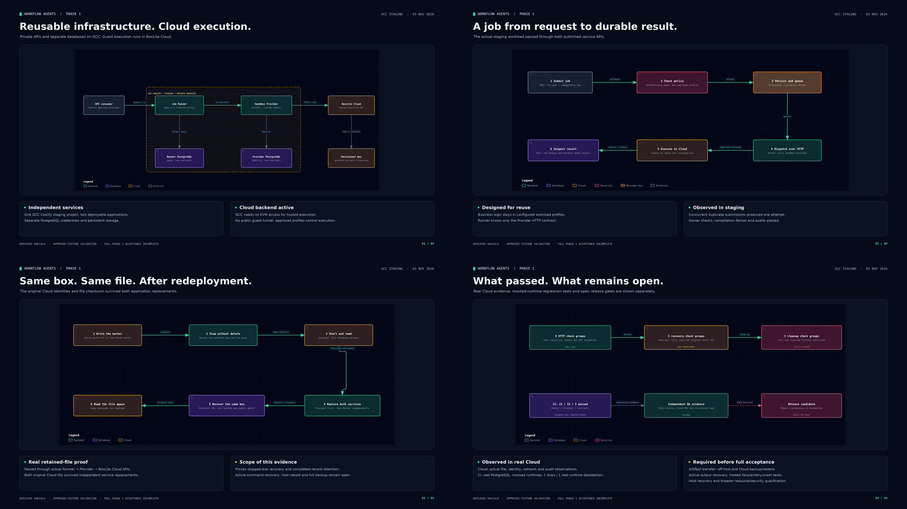

# Workflow Agents

Reusable infrastructure for queuing jobs and running approved workloads in persistent isolated environments.

**Current status: infrastructure contract candidate `1.0.0-rc.2` and minimal application candidate `0.1.0-rc.1`. Stable acceptance remains incomplete.** Scoped files, verified Cloud completion, failure recovery tests and encrypted application checkpoints extend the merged Phase 1 services. The [initial application scope](docs/release/MINIMAL-SCOPE.md) contains only submission, a persistent authorized list and results. [Current validation](docs/phase1/CLOUD-VALIDATION.md), [readiness gates](docs/phase1/readiness.json) and [independent QA](docs/qa/CLOUD-REVIEW.md) record the evidence and remaining limits.

## Services and execution flow

| Service | Stack | Responsibility |
| --- | --- | --- |
| [Job Runner](services/job-runner/README.md) | Node.js 22+, TypeScript, Fastify, Graphile Worker, PostgreSQL | Authenticated submissions, queueing, scheduling, retry policy, cancellation, execution status and audits |
| [Sandbox Provider](services/sandbox-provider/README.md) | Python 3.12, FastAPI, Psycopg, BoxLite SDK 0.11.0, PostgreSQL | Approved workload execution, scoped files, persistent sandbox identity, start, stop, explicit destruction and audits |
| [Request application](apps/application/README.md) | React, Fastify, own PostgreSQL and private RustFS | Instructions/attachments, persistent paginated requests, independently checked text/file results |
| [Pi document workload](workloads/pi-document-agent/README.md) | Pinned Node, Pi, OfficeCLI archive; existing LiteLLM | Constrained working-copy editing, structured manifests, validation findings and session checkpoints |

A client submits a generic job to Runner. Runner commits the job and queue work to its own database, then calls Provider through its versioned REST API. Provider executes an approved profile through a runtime adapter and stores lifecycle and run records in its own database. Clients poll job status and durable events.

The two services deploy independently. They share neither database credentials nor source-level runtime integrations. Runner has no BoxLite SDK dependency.

## Where it runs

Both APIs and their separate PostgreSQL databases are private resources in GCC Coolify's `workflow-agents-phase1` project, environment `staging`. The Sandbox Provider API is self-hosted on GCC. **The guest VMs and their writable disks run in BoxLite Cloud.** Active Cloud mode does not require GCC KVM access.

All three applications currently run source `8387b5da2084e062e7409b1af5ce81ae57b45dfd`. The [delivery record](docs/release/DELIVERY.md) separates exact deployments, executed checks and remaining gates. Documentation pushes do not redeploy services. [Deployment configuration and recovery instructions](deploy/README.md) describe commit pinning, private networking, secret injection and storage.

Only the authenticated request application may be public over HTTPS. The private services expose authenticated `/v1` APIs, health endpoints, owner-scoped metrics and JSON OpenAPI documents. Swagger and ReDoc are disabled. The broader Phase 2 dashboard, chat, approval and revision flows are deferred.

## Contracts and documentation

| Start here | Content |
| --- | --- |
| [Root AGENTS.md](AGENTS.md) | Architecture, stack, working rules, commands, deployment boundaries and known limits |
| [Closeout: 3 November 2026](docs/phase1/CLOSEOUT-2026-11-03.md) | What was delivered, what was verified and what remains |
| [Phase 1 requirements](PHASE-1-REUSABLE-SERVICES.md) | Primary implementation requirements; original handoff text is preserved |
| [Architecture context](PROJECT-DOCUMENTATION-ASSISTANT-LIGHTWEIGHT.md) | Service separation and future consumer context |
| [API compatibility rules](docs/contracts/v1.md) | Authentication, lifecycle, errors, idempotency and versioning |
| [Runner OpenAPI](contracts/v1/runner-v1.openapi.json) | Frozen Runner `/v1` candidate contract |
| [Provider OpenAPI](contracts/v1/provider-v1.openapi.json) | Frozen Provider `/v1` candidate contract |
| [Validation diagrams](docs/phase1/visuals/README.md) | Architecture, request flow, filesystem retention proof and open gates |
| [Phase 2 requirements](PHASE-2-DOCUMENT-ASSISTANT.md) | Broader context; initial release is explicitly narrowed by [minimal scope](docs/release/MINIMAL-SCOPE.md) |

Historical local-runtime and migration reports remain under `docs/phase1/`. The current delivery record is `CLOUD-VALIDATION.md`; older test counts and host blockers describe their recorded environment and time.

## Develop and test

Each service is independently buildable from its own directory. Use the [Runner setup](services/job-runner/README.md) and [Provider setup](services/sandbox-provider/README.md) for exact dependency, environment, migration, test and Docker commands. There is no root application install command.

Tests require dedicated disposable PostgreSQL databases. Runner integration tests drop its schemas; Provider tests truncate registry tables. Never point `TEST_DATABASE_URL` at staging, production or retained operational data.

[GitHub Actions](.github/workflows/phase1.yml) validates contracts, Runner typechecking/build/tests and Provider tests against real PostgreSQL. CI uses mocked runtimes and SDK loopback HTTP. Real Cloud execution is supported by separate deployed evidence, not by CI alone.

Agent instructions and verified procedures are maintained with each service:

- Runner: [AGENTS.md](services/job-runner/AGENTS.md), [development skill](services/job-runner/.agents/skills/job-runner-development/SKILL.md), [operations skill](services/job-runner/.agents/skills/job-runner-operations/SKILL.md).
- Provider: [AGENTS.md](services/sandbox-provider/AGENTS.md), [development skill](services/sandbox-provider/.agents/skills/sandbox-provider-development/SKILL.md), [operations skill](services/sandbox-provider/.agents/skills/sandbox-provider-operations/SKILL.md).

## Remaining release work

The [machine-readable gates](docs/phase1/readiness.json) separate implementation and bounded Cloud evidence from remaining stable acceptance. Active attach stays ambiguous without replay; host restart, comprehensive escape/network/load qualification and full guest-disk recovery remain unverified or vendor blocked. Same-box stop/start, required-file checkpoints and a runtime archive do not prove a VM clone or full host recovery.

The application and workload consume versioned APIs and approved profiles. Pi, OfficeCLI and document semantics remain outside Runner and Provider. RustFS is self-hosted application storage; encrypted exports are separately copied off-host, without a Coolify S3 backup destination.
