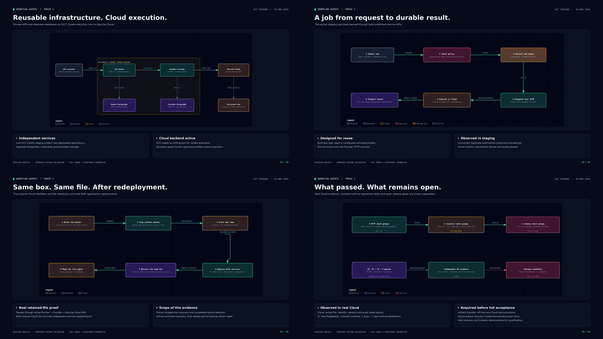

# Phase 1 validation diagrams

These diagrams explain the validation recorded on 3 November 2026. They are illustrations based on evidence, not screenshots of an application dashboard.

| Diagram | Presentation PNG | Editable SVG | Interactive HTML |
| --- | --- | --- | --- |
| Independent services and hosted execution | [Dark](01-architecture.png), [light](01-architecture.light.png) | [Architecture SVG](vectors/01-architecture.svg) | [Architecture diagram](01-architecture.html) |
| A job through both APIs | [Dark](02-job-flow.png), [light](02-job-flow.light.png) | [Job flow SVG](vectors/02-job-flow.svg) | [Job flow diagram](02-job-flow.html) |
| Same-box file retention and service replacement | [Dark](03-retention-proof.png), [light](03-retention-proof.light.png) | [Retention SVG](vectors/03-retention-proof.svg) | [Retention diagram](03-retention-proof.html) |
| Passed checks and incomplete release gates | [Dark](04-validation.png), [light](04-validation.light.png) | [Validation SVG](vectors/04-validation.svg) | [Validation diagram](04-validation.html) |

Presentation PNGs are 3840 x 2160. Open the [gallery](index.html) or a diagram locally in a browser to use interactive controls and exports. GitHub displays source for HTML files; it does not host this gallery as a deployed site. Editable JSON specifications are in `specs/`.

## Evidence and limits

The source is [Cloud validation](../CLOUD-VALIDATION.md) and its independent QA records. Recorded deployed source is `04b7dc46dc8e1bc6c126f8304823c4739d5ec5c9`. Real Cloud observations and mocked-runtime CI are separate. Artifact transfer, active-command/output recovery, hosted failure injection, full backup/restore, host restart and broader security/resource qualification remain open. No Phase 2 readiness or comprehensive sandbox security certification is implied.

## Provenance

The original diagrams were generated with the Archify skill using deterministic SVG and HTML rendering. Pillow composed the final presentation PNGs. No image-generation API was used.

The recorded generation review passed nine artifact checks per diagram with zero errors and warnings. Containment checks covered 1440 x 900, 1600 x 1000, 1920 x 1080 and 2048 x 1320. Actual light/dark captures and presentation images were inspected during that generation session. These are the earlier recorded visual checks, not new runtime validation performed during repository cleanup.

[manifest.json](manifest.json) records curated asset hashes, the frozen specification and interactive hashes, and the original review statements. Interactive diagrams, specifications and presentation images retain their original bytes. SVG trailing whitespace was removed without changing diagram content. The gallery's local ZIP link was replaced with the validation report link.

Duplicate raw raster exports, the local composition script, ZIP bundles and browser-review screenshots remain in ignored local `output/validation-showcase/`. They are not required to view or edit the diagrams. The curated set does not include a standalone rebuild of the presentation framing.
